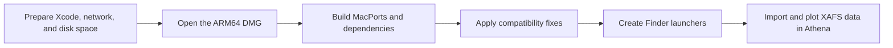

# XAFS_DemeterPerl_MacOS

Athena and Demeter on macOS 27.2

This repository provides an online installer for **Athena**, the X-ray absorption fine structure (XAFS) data processing application in the [Demeter](https://bruceravel.github.io/demeter/) suite. The DMG targets **macOS 27.2 on Apple silicon (arm64)**. It also sets up Finder launchers for Artemis, Hephaestus, and Stand-alone Atoms.

## Download

Go to the [Releases page](https://github.com/gaoxiao0041/XAFS_DemeterPerl_MacOS/releases) and look under **Assets** for `Demeter-macOS-27.2-instal-arm64.dmg`.

The DMG contains the installation scripts and compatibility patches. During installation, it downloads and builds Demeter and its dependencies in a separate MacPorts environment under your home directory.

## Requirements

- A Mac with Apple silicon running macOS 27.2
- The full Xcode application, opened at least once to complete its license and initial setup
- An internet connection and at least 30 GiB of free disk space

## What the installer sets up

The full Xcode application, a working network connection, and free disk space are prerequisites. The installer builds the software stack below in a dedicated environment under `~/demeter-mac`. It uses a fixed MacPorts ports snapshot so the included patches apply to the dependency versions they were written for.

| Layer | Components | Purpose |
| --- | --- | --- |
| Package management | MacPorts 2.12.7 and a pinned ports tree | Builds and manages dependencies in a separate prefix |
| Compiler and runtime | GCC / GFortran and Perl 5.34 | Builds the Fortran backend and runs the Demeter scripts |
| XAFS computation | Ifeffit and its Perl bindings, PDL, CFITSIO | Provides the numerical backend and scientific data support |
| GUI and plotting | Perl Wx, wxWidgets 3.0.5.1, gnuplot, and X11 | Opens the application windows and displays plots |
| Desktop applications | Demeter 0.9.26 and four Finder launchers | Provides Athena, Artemis, Hephaestus, and Stand-alone Atoms in `~/Applications` |



The compatibility work includes patches for dependency builds and a rebuilt wxWidgets Cocoa library to address a crash in the gradient drawing callback. The launchers set the Perl module and dynamic library paths for the dedicated environment.

## Installation

1. Open the DMG and launch **Demeter Installer.app**.
2. Click **开始联网安装** (Start Online Installation). The installer opens Terminal to download and build the dependencies.
3. Keep Terminal open until the installer reports completion. The first build may take several hours.
4. In Finder, press **Shift–Command–G**, enter `~/Applications`, and open **Athena.app**. Import an XAFS data file and plot it to check that both data import and plotting work.

## Verify the installation

In Athena, load a known XAFS project, select a data group, and plot it in **E** and **k**. This checks data import, the calculation backend, and plotting. Open Artemis and check its FEFF entry point. In Hephaestus, look up an elemental absorption edge. In Stand-alone Atoms, load a known structure and check the lattice parameters and atom list.

## Troubleshooting

Start with the installer log. Run this in a separate Terminal window to follow progress while the installer runs.

```sh
tail -f "$HOME/demeter-mac/logs/install.log"
```

| Symptom | What to check |
| --- | --- |
| A download fails with `Could not resolve host` | Check DNS and network access to the source host, then retry. |
| A dependency build fails | Find the first compiler or configure error in the log. Note the failing port and collect its MacPorts build log. |
| `Can't locate … .pm` | Check that the launcher uses the installed Perl 5.34 and the expected `PERL5LIB`. |
| `Library not loaded` | Use `otool -L` on the affected binary or library and check its dependency paths and architecture. |
| The window crashes with `CalculateShadingValues` in the report | Check that the launcher loads the patched wxWidgets Cocoa library. |
| Athena opens but no plot appears | Check gnuplot with an offscreen PNG plot, then check the X11 server, `DISPLAY`, and the configured gnuplot terminal for interactive plots. |

When reporting a problem, include your macOS version, Mac chip, failing step, and the first error with its surrounding log lines.

## Compatibility and release status

This is an unofficial installer with an ad hoc signature and no Apple notarization. If macOS blocks it, verify the source and use the per-app **Open Anyway** option in **System Settings → Privacy & Security**. The package has been checked locally. A complete clean installation on a second Mac has yet to be verified, and Intel Macs and other macOS versions are outside this release's tested scope.
